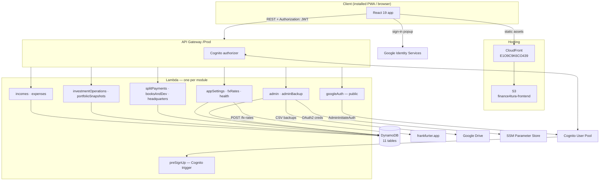
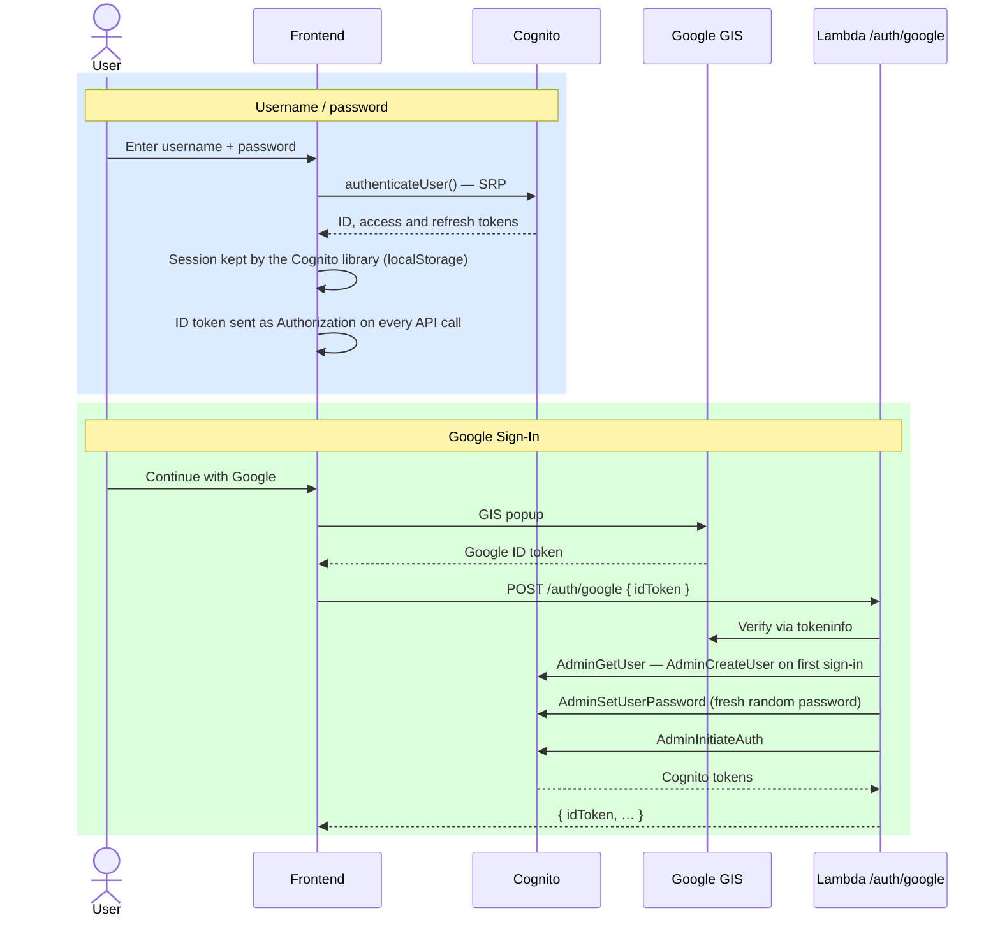
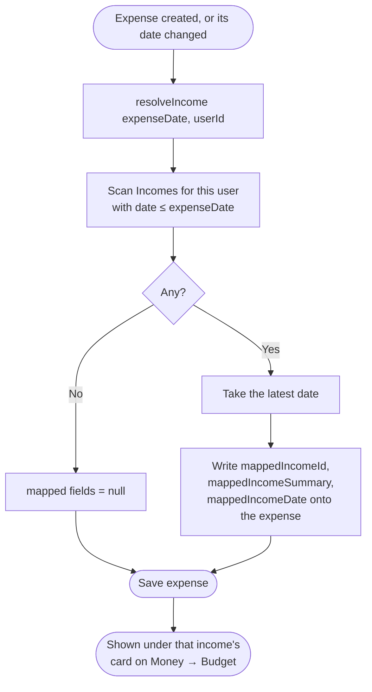
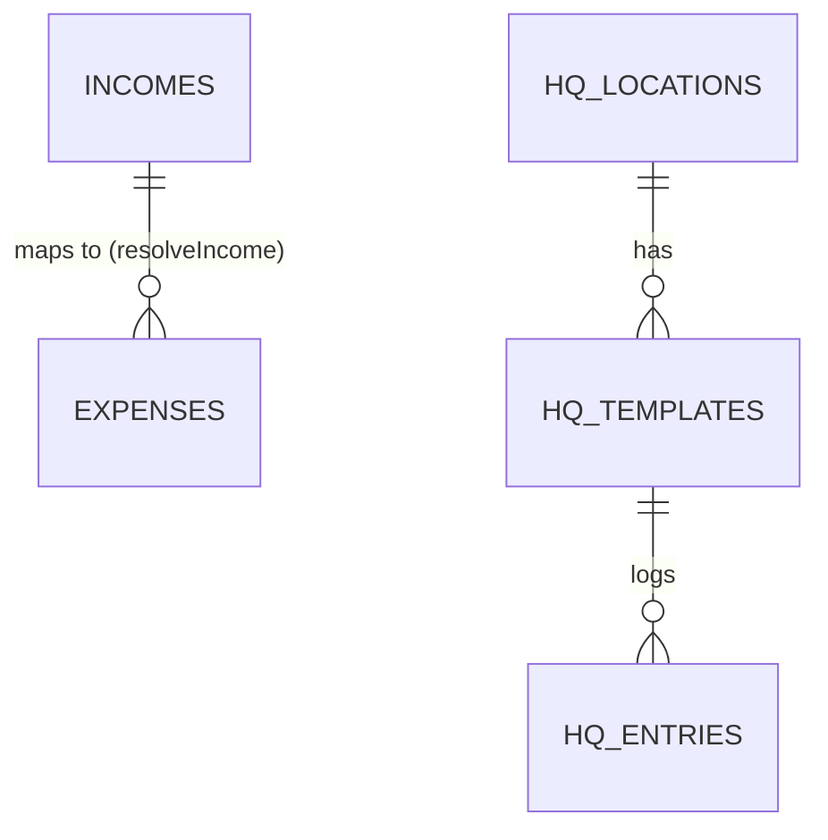

# 4TURA Home

> **Personal dashboard PWA** built around a budget: incomes arrive periodically, and every expense maps automatically to the most recent income before its date. Around it sit split payments, an investment portfolio, statistics, a reading log and home-utility tracking.

[](https://d34ylrmixnmvem.cloudfront.net)
[](https://2t55twyqmh.execute-api.eu-central-1.amazonaws.com/Prod/health)
[](https://nodejs.org)
[](https://react.dev)
[](https://web.dev/progressive-web-apps/)

**Production URL:** https://d34ylrmixnmvem.cloudfront.net

The repository, CloudFormation stack and S3 bucket keep the original name, **Finance4Tura**.

---

## Table of Contents

1. [Project Overview](#1-project-overview)
2. [Getting Started](#2-getting-started)
3. [Development Commands](#3-development-commands)
4. [System Architecture](#4-system-architecture)
5. [Navigation and Pages](#5-navigation-and-pages)
6. [Authentication Flow](#6-authentication-flow)
7. [Income Mapping Logic](#7-income-mapping-logic)
8. [Data Model](#8-data-model)
9. [API Reference](#9-api-reference)
10. [Environment Variables](#10-environment-variables)
11. [AWS Infrastructure](#11-aws-infrastructure)
12. [File Structure](#12-file-structure)
13. [Design Decisions](#13-design-decisions)
14. [Further Documentation](#14-further-documentation)

---

## 1. Project Overview

The core model is simple: **income defines a period, and every expense belongs to the period opened by the most recent income before it.**

### Core Concepts

| Concept | Description |
|---|---|
| **Income period** | Every income record opens a new budget period. Expenses between two income dates belong to the earlier income. |
| **Auto-mapping** | When an expense is created or its date changes, `resolveIncome` finds the latest income with `date <= expenseDate` and denormalizes its ID, summary and date onto the expense. |
| **Repeating events** | Incomes and expenses support daily/weekly/monthly recurrence. Occurrences are expanded into individual records at creation time, linked by a `seriesId`. |
| **Series editing** | Editing one occurrence sets `isException: true` on that record only. The `/series` endpoint updates all future occurrences. |
| **Special expenses** | `special: true` marks an expense with ★ and a red row background, and lists it in Statistics. |
| **Two layouts** | The app is a phone-width PWA (a centred 430 px column on any screen). **One-Page** (`/one-page`) is a separate desktop dashboard with Money, Library and HQ on one screen. |

### Modules

| Module | Route | What it does |
|---|---|---|
| Today | `/` | This period's outstanding expenses, the 3 newest open split payments, holdings (hold to reveal), latest book per person |
| Money → Budget | `/money` | One income period at a time (scroll-snap pager), budget bar, expenses; expense/income forms open as sheets |
| Money → Split | `/money/split` | Payments split into instalments, tracked until settled |
| Money → Stats | `/money/stats` | Monthly averages, free amount per month, special expenses |
| Money → Invest | `/money/invest` | Portfolio across six platforms, in EUR, with history since 2023 |
| Library | `/library` | Reading and training log per person, with ratings |
| HQ | `/hq` | Meter readings per location, with water-consumption charts |
| Settings | `/settings` | Theme and income-amount privacy |
| Backstage | `/backstage` | Raw table viewer and a live API log (when enabled) |
| Admin | `/admin` | App settings, FX rates, backups, users (admin only) |

### Tech Stack

| Layer | Technology |
|---|---|
| Frontend | React 19, Vite, React Router, Recharts, Day.js, Axios, PWA (vite-plugin-pwa) |
| Backend | AWS SAM, Node.js 22, AWS Lambda |
| Database | AWS DynamoDB (on-demand) |
| Auth | AWS Cognito User Pool + Google Identity Services (GIS) |
| Hosting | S3 (frontend assets) + CloudFront |
| IaC | AWS SAM / CloudFormation (`backend/template.yaml`) |
| Tests | Vitest + Testing Library (frontend), `node --test` (backend) |

---

## 2. Getting Started

**There is no local backend.** DynamoDB Local and `sam local` were removed; the app runs against AWS only.

### Prerequisites

- Node.js 22+
- AWS CLI configured for account `980921747943`
- [AWS SAM CLI](https://docs.aws.amazon.com/serverless-application-model/latest/developerguide/install-sam-cli.html) (backend deploys only)

### Run the frontend

```bash
cd frontend
npm install
npm run dev    # http://localhost:5173 — talks to the deployed API
```

> ⚠️ A dev session uses the **production API and production data**. Anything you create, edit or delete is real.

Sign in with a Cognito username and password, or with **Continue with Google** when it's enabled in Admin → App Settings.

---

## 3. Development Commands

| Task | Command |
|---|---|
| Frontend dev server | `cd frontend && npm run dev` |
| Frontend tests | `cd frontend && npm test` |
| Lint frontend | `cd frontend && npm run lint` |
| Build frontend | `cd frontend && npm run build` |
| Backend tests | `cd backend && npm test` |
| Build backend | `cd backend && ulimit -n 10240 && sam build --no-cached` |
| Deploy backend | `cd backend && sam deploy` (after the build) |
| Deploy frontend | see below |

### Deploy the frontend

```bash
cd frontend && npm run build
aws s3 sync dist s3://finance4tura-frontend --region eu-central-1 --delete
aws cloudfront create-invalidation --distribution-id E1O9C9K6CO439 --paths "/*" --region us-east-1
```

When both change, deploy the backend first. Full details are in [`Documentation/AWS_Sync.md`](Documentation/AWS_Sync.md).

---

## 4. System Architecture



---

## 5. Navigation and Pages

- **Tab bar**: Today · Money · Library · HQ. Money has a segmented control: Budget · Split · Stats · Invest.
- **Account sheet** (initials, top right): username, session countdown, Settings, Backstage (when enabled), Admin (admin only), Sign Out.
- System back (Android) closes the top sheet or menu first; iPhone gets an edge swipe on pushed screens. Old URLs redirect. Details in `CLAUDE.md`.
- **One-Page** (`/one-page`, desktop): up to four columns of blocks — Budget and Budget Statistics; Split, Investment Statistics, Investments and **Portfolio v2**; HQ Statistics and HQ; Library Statistics and Library. Reached by URL, from the Account sheet on screens ≥ 1024 px, or automatically with Settings → Desktop → *Open One-Page on this computer*. Spec: `Documentation/OnePage_Desktop_Proposal.md`.


---

## 6. Authentication Flow



- New sign-ups are auto-confirmed by the Cognito pre-sign-up trigger.
- Sign-up and Google sign-in can each be switched off in Admin → App Settings.
- There is no token refresh: when the ID token expires, the next 401 signs the user out. The Account sheet shows the time left.
- Google users get a new random password on every sign-in, so no password can be derived or reused. See CLAUDE.md, "Google Sign-In credential design".

---

## 7. Income Mapping Logic



For a repeating expense, every occurrence is mapped on its own date. `scripts/remap-expenses.mjs` re-runs the mapping over every expense after bulk income changes.

---

## 8. Data Model

All tables use pay-per-request billing and a single string hash key. Per-user tables carry `userId` (the Cognito `sub`).

| Table | Key | Contents |
|---|---|---|
| `Incomes` | `incomeId` | summary, date, amount, currency, series fields. GSI `date-index` |
| `Expenses` | `expenseId` | as Incomes + priority, status, special, mapped-income fields. GSI `date-index` |
| `SplitPayments` | `splitPaymentId` | title, totalAmount, currency, occurrenceCount, occurrenceType, createdDate, occurrences |
| `InvestmentOperations` | `operationId` | date, type (Deposit/Withdrawal), platform, amount, currency, notes |
| `PortfolioSnapshots` | `snapshotId` | date, platform, amount, currency — one row per platform per reading |
| `Books_and_Dev` | `bookId` | name (person), type, source, author, title, dateCompleted (YYYY-MM), rating, comments |
| `HQ_Locations` | `hqId` | name, address, order |
| `HQ_Templates` | `templateId` | hqId, name, parameters (max 30) |
| `HQ_Entries` | `entryId` | templateId, hqId, date, values, notes |
| `AppSettings` | `settingKey` | one global item: backstageEnabled, googleLoginEnabled, createAccountEnabled |
| `FxRates` | `rateId` | one global item: the EUR/USD/RON rate matrix and updatedAt |



**Field notes:**
- `repeatFrequency`: `daily` | `weekly` | `monthly`
- `priority`: `High` | `Medium` | `Low`; `status`: `Pending` | `Completed`
- `isException`: `true` when one series occurrence was edited on its own
- SplitPayments `occurrences`: `[{ index, value }]`, where `value` is an amount, a `YYYY-MM-DD` date, or `""`
- FxRates `rates[FROM][TO]` is the value of 1 `FROM` in `TO`

Full field lists are in [CLAUDE.md](CLAUDE.md#database-schema).

---

## 9. API Reference

**Base URL:** `https://2t55twyqmh.execute-api.eu-central-1.amazonaws.com/Prod`

Protected routes need `Authorization: <Cognito ID token>` (no `Bearer` prefix). Admin routes also need the caller to be in the Cognito `admin` group.

| Area | Routes | Auth |
|---|---|---|
| Auth | `POST /auth/google` | public |
| Health | `GET /health` | Cognito |
| Incomes | `POST /incomes` · `GET /incomes?from=&to=` · `GET/PUT/DELETE /incomes/{id}` · `PUT /incomes/{id}/series` · `DELETE …?deleteSeries=true` | Cognito |
| Expenses | as Incomes, plus `GET /expenses/resolve-income?date=` | Cognito |
| Investments | `GET/POST /investments/operations` · `PUT/DELETE /investments/operations/{id}` · `GET /investments/snapshots` · `GET /investments/snapshots/latest` · `POST /investments/snapshots` · `PUT/DELETE /investments/snapshots/{id}` | Cognito |
| Split Payments | `GET/POST /split-payments` · `PUT/DELETE /split-payments/{id}` | Cognito |
| Books & Dev | `GET/POST /books-and-dev` · `PUT/DELETE /books-and-dev/{id}` | Cognito |
| Headquarters | `GET/POST /headquarters` · `PUT/DELETE /headquarters/{hqId}` · same under `/headquarters/templates` and `/headquarters/entries` | Cognito |
| App Settings | `GET /app-settings` (public) · `PUT /app-settings` | admin for PUT |
| Portfolio v2 | `GET/POST /portfolio-v2/assets` · `PUT/DELETE /portfolio-v2/assets/{id}` · `POST /portfolio-v2/assets/import` · `GET /portfolio-v2/snapshots[/latest]` · `GET/POST /portfolio-v2/runs` · `GET /portfolio-v2/runs/{id}` · `POST /portfolio-v2/runs/{id}/cancel|retry` · `GET/PUT /portfolio-v2/ai-config` | Cognito; admin for PUT ai-config |
| FX Rates | `GET /fx-rates` (public) · `POST /fx-rates` (refresh EUR, RON, USD, GBP, CHF from frankfurter.app) | admin for POST |
| Admin users | `GET /admin/users` · `PUT /admin/users/{username}/role` · `DELETE /admin/users/{username}` | admin |
| Backups | `GET /admin/backup/preview` · `POST /admin/backup/prepare` · `POST /admin/backup/run-table` | admin |

Notable behaviour:
- `PUT /incomes/{id}` and `PUT /expenses/{id}` on a series member set `isException: true`.
- `PUT /expenses/{id}` re-runs income mapping when the date changes.
- Incomes and expenses with `amount <= 0` are rejected with 400.
- `DELETE /headquarters/{hqId}` returns 400 while the location still has templates.
- Every response carries `Cache-Control: no-store`.

---

## 10. Environment Variables

### Frontend

`frontend/.env.production` (and `.env.local` for `npm run dev`, which uses the same production values):

| Variable | Value |
|---|---|
| `VITE_API_BASE_URL` | `https://2t55twyqmh.execute-api.eu-central-1.amazonaws.com/Prod` |
| `VITE_COGNITO_USER_POOL_ID` | `eu-central-1_CD7AdBFwQ` |
| `VITE_COGNITO_CLIENT_ID` | `2nh5dljhrg9mq7nsmdg7cef21v` |
| `VITE_COGNITO_REGION` | `eu-central-1` |
| `VITE_GOOGLE_CLIENT_ID` | Google OAuth client ID |

> `vite.config.js` must keep `define: { global: 'globalThis' }` for `amazon-cognito-identity-js`.

### Backend

Set in `backend/template.yaml`:

| Variable | Used by | Notes |
|---|---|---|
| `*_TABLE` (11) | all handlers | Table names, set globally |
| `USER_POOL_ID`, `CLIENT_ID` | googleAuth, admin | Cognito pool and app client |
| `GOOGLE_CLIENT_ID` | googleAuth | From the `GoogleClientId` parameter in `samconfig.toml` |
| `GDRIVE_BACKUP_FOLDER_ID` | adminBackup | Parent Drive folder for backups |

The backup Lambda reads its Google Drive OAuth2 credentials from SSM at `/finance4tura/gdrive-oauth2`.

---

## 11. AWS Infrastructure

| Resource | Value |
|---|---|
| CloudFormation stack | `finance4tura-backend` |
| API Gateway URL | `https://2t55twyqmh.execute-api.eu-central-1.amazonaws.com/Prod` |
| S3 bucket (frontend) | `finance4tura-frontend` |
| CloudFront distribution | `E1O9C9K6CO439` — `d34ylrmixnmvem.cloudfront.net` |
| Cognito User Pool | `eu-central-1_CD7AdBFwQ` — app client `2nh5dljhrg9mq7nsmdg7cef21v`, group `admin` |
| AWS Region | `eu-central-1` |

The Cognito user pool is shared with the sibling **TYG** app (`../TYG`), which has its own stack. This stack owns the pool's pre-sign-up trigger.

---

## 12. File Structure

```
4TURAHome/
├── frontend/
│   ├── public/                       # App icons, PWA icons
│   ├── src/
│   │   ├── api/                      # One module per backend area + client.js (axios, auth header, opLog)
│   │   ├── theme/                    # Tokens, Light/Dark themes (only raw colours), ThemeProvider
│   │   ├── ui/                       # Component library (React Aria + Motion, CSS Modules)
│   │   ├── app/                      # Shell, tab bar, nav bar, account sheet, routes, history/back handling
│   │   ├── features/                 # today, money/{budget,split,stats,invest,forms}, library, hq, account, auth, one-page
│   │   ├── data/                     # TanStack Query hooks
│   │   ├── context/                  # Auth, AppSettings, Year, Privacy
│   │   ├── utils/                    # format, money, split, parseAmount
│   │   └── test/                     # Setup, render helper, logic tests, build guards
│   ├── e2e/                          # Playwright specs + stubbed harness
│   ├── scripts/                      # check-bundle.mjs, generate-pwa-assets.mjs
│   ├── .env.production
│   └── vite.config.js
│
├── backend/
│   ├── template.yaml                 # SAM / CloudFormation stack
│   ├── samconfig.toml                # Deploy defaults
│   └── src/
│       ├── handlers/                 # One file per Lambda (+ *.test.mjs)
│       └── lib/                      # dynamo.mjs, expandDates.mjs (+ tests)
│
├── scripts/
│   └── remap-expenses.mjs            # Re-map every expense to its income (cloud)
│
├── Documentation/                    # Deploy guides and module requirements
├── CLAUDE.md                         # Detailed architecture and conventions
└── README.md
```

---

## 13. Design Decisions

| Decision | Choice | Rationale |
|---|---|---|
| Recurring events | Expand to individual records at write time | No expansion logic on read; each record is independently editable. |
| Income mapping | Denormalized onto the expense | Budget renders without joins; mapping is computed once at write time. |
| Series editing | Single edits set `isException`; `/series` updates future records | Past records stay untouched while bulk corrections stay possible. |
| One phone-width layout | The same 430 px column everywhere | Used mainly as an installed PWA; one layout removes the desktop/mobile divergence. |
| One-Page | A separate desktop route reusing the PWA's data, forms and components | Desktop use without a second app: shared components present as dialogs and hover actions there. |
| Navigation | Today · Money · Library · HQ; Money sections as a segmented control; account sheet for settings/admin | Every area visible; back behaves natively on Android and iPhone. |
| Design | Apple-style, Light/Dark/Automatic, see `Documentation/Frontend_Redesign_Proposal.md` | iPhone feel on every phone. |
| AWS only | No local backend | One environment to keep correct. Dev sessions use production data. |
| Frontend hosting | S3 + CloudFront | Static site, HTTPS, CDN, no server. |
| Authentication | Cognito + GIS popup via a custom Lambda | Cognito handles JWTs; Google sign-in works without Hosted UI redirects. |
| Cache-Control | `no-store` on every response | Stops API Gateway's CloudFront layer serving stale per-user data. |
| FX rates | Stored once, refreshed by an admin | Pages never call a third party at load time. |
| Portfolio v2 prices | An AI agent (Claude + web search) reports prices with sources; code does every calculation | Official sources only, a snapshot only when there is new data, and every number is reproducible from units × price × FX. |
| Design tokens | All colours, radii, shadows, spacing and type as CSS variables | A test fails the build on raw values outside the token files. |

---

## 14. Further Documentation

| Document | Contents |
|---|---|
| [CLAUDE.md](CLAUDE.md) | Full architecture, per-module behaviour, schema, tests, conventions |
| [Documentation/AWS_Deploy.md](Documentation/AWS_Deploy.md) | How the AWS environment is built, for a rebuild from scratch |
| [Documentation/AWS_Sync.md](Documentation/AWS_Sync.md) | Day-to-day deploys, logs, rollbacks, Cognito admin |
| [Documentation/Frontend_Setup.md](Documentation/Frontend_Setup.md) | Frontend structure and conventions |
| [Documentation/OnePage_Desktop_Proposal.md](Documentation/OnePage_Desktop_Proposal.md) | One-Page, the desktop dashboard: design and implementation notes |
| [Documentation/Requirements.md](Documentation/Requirements.md) | Requirements by phase, kept current with the app |
| [Documentation/SplitPayment_Requirement.md](Documentation/SplitPayment_Requirement.md) | Split Payments |
| [Documentation/Investments_Requirement.md](Documentation/Investments_Requirement.md) | Investments |
| [Documentation/Headquarters_Requirements.md](Documentation/Headquarters_Requirements.md) | Headquarters |
| [Documentation/Backup_Requirements.md](Documentation/Backup_Requirements.md) | Admin database backup to Google Drive |
